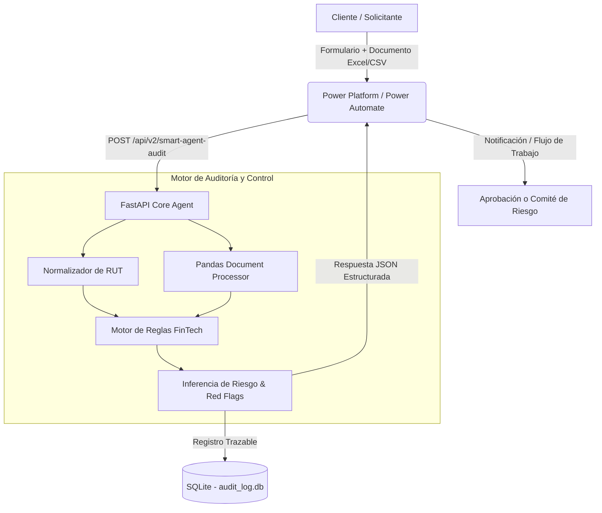

# Next-Gen AI Banking Risk & Cross-Audit Agent 🏦🤖

Agente Inteligente de Auditoría Preventiva, Inferencia Multimodal y Análisis de Riesgo Crediticio diseñado para la automatización de procesos de onboarding, control operacional y evaluación financiera en **Banco de Chile**.

Este proyecto resuelve el desafío de procesar solicitudes de crédito de forma automatizada, reemplazando las revisiones manuales de carpetas tributarias/financieras por una arquitectura rápida, trazable e integrada con la nube.

---

## 🎯 ¿Qué hace el sistema y para qué sirve?

El sistema actúa como un **Agente Auditor de Riesgo** que evalúa las solicitudes de crédito de los clientes en tiempo real:

1. **Ingesta de Solicitudes:** Recibe los datos del solicitante (RUT, renta declarada, monto del crédito solicitado) y la evidencia documental adjunta (carpetas tributarias o liquidaciones en formato Excel/CSV).
2. **Normalización e Identificación:** Limpia y estandariza el formato del RUT (removiendo puntos, guiones y espacios) para permitir búsquedas exactas sobre bases de datos o archivos históricos.
3. **Auditoría Cruzada Documental:** Compara la renta declarada por el cliente contra los registros reales del archivo adjunto para verificar la veracidad de la información y detectar inconsistencias o suplantaciones.
4. **Evaluación de Riesgo y Banderas Rojas (*Red Flags*):** Calcula el nivel de palanca crediticia (ratio entre monto solicitado e ingreso) y genera alertas automáticas si el endeudamiento supera los límites normativos del banco (>10x).
5. **Inferencia y Toma de Decisiones:** Clasifica la solicitud en tres niveles de riesgo (`BAJO`, `MEDIO`, `CRÍTICO`) y sugiere una acción automática: `APROBACIÓN_AUTOMÁTICA`, `REVISIÓN_COMITÉ_RIESGO` o `RECHAZO_AUTOMATICO`.
6. **Bitácora de Trazabilidad Bancaria:** Registra cada evaluación con fecha, hora, parámetros y decisiones en una base de datos SQL para permitir auditorías posteriores y alimentar paneles de control ejecutivo.
7. **Consumo por Herramientas Low-Code:** Expone contratos OpenAPI para conectarse mediante conectores personalizados (*Custom Connectors*) con **Power Automate** y **Power Apps**.

---

## 🛠️ Tecnologías Utilizadas y Función de Cada Una

| Tecnología / Librería | Tipo | Función en el Proyecto |
| :--- | :--- | :--- |
| **Python 3.11+** | Lenguaje Principal | Base lógica para el procesamiento de datos, cálculos financieros y orquestación del backend. |
| **FastAPI** | Framework Web (API) | Exposición de endpoints RESTful asíncronos de alto rendimiento para el análisis e historial. |
| **Uvicorn** | Servidor ASGI | Servidor web que ejecuta la aplicación FastAPI y atiende solicitudes HTTP en tiempo real. |
| **Pandas** | Procesamiento de Datos | Lectura, filtrado y manipulación eficiente de matrices de datos en formatos Excel (`.xlsx`) y CSV. |
| **OpenPyXL** | Motor de Archivos | Soporte técnico subyacente para la lectura e interpretación de hojas de cálculo de Microsoft Excel. |
| **SQLite3** | Base de Datos Relacional | Almacenamiento persistente y estructurado de la bitácora de auditoría (`audit_log.db`) para trazabilidad. |
| **Pydantic** | Validación de Esquemas | Definición rigurosa de modelos de datos, asegurando tipos de entrada y respuestas JSON estandarizadas. |
| **Swagger UI / OpenAPI** | Documentación / Estándar | Interfaz gráfica interactiva (`/docs`) y especificación en JSON que habilita la integración con Power Platform. |
| **Git & GitHub** | Control de Versiones | Versionado de código, gestión de cambios e integración continua para el trabajo colaborativo. |
| **GitHub Copilot / IA** | Asistencia al Desarrollo | Aceleración en la generación de código, pruebas unitarias (`pytest`) y documentación técnica. |

---

## 📐 Arquitectura del Sistema



---

## 📁 Estructura del Repositorio

```text
smart-banking-onboarding/
│
├── backend/
│   ├── app/
│   │   ├── __init__.py
│   │   └── main.py              # Código principal: endpoints FastAPI, lógica del agente y SQLite
│   ├── tests/
│   │   └── test_main.py         # Pruebas unitarias para validación del backend
│   ├── audit_log.db             # Base de datos SQLite para trazabilidad (generada automáticamente)
│   └── requirements.txt         # Lista de dependencias de Python
│
├── docs/
│   └── COPILOT_DEVELOPMENT_LOG.md # Bitácora de asistencia con GitHub Copilot e IA Generativa
│
├── .gitignore                   # Archivos excluidos del control de versiones
└── README.md                    # Documentación principal del proyecto
```

---

## 🚀 Guía de Instalación y Ejecución Local

### Prerrequisitos
* Python 3.11 o superior instalado.
* Git configurado.

### Pasos para Ejecutar
1. **Clonar el repositorio:**
   ```bash
   git clone [https://github.com/jocetapiadev/smart-banking-onboarding.git](https://github.com/jocetapiadev/smart-banking-onboarding.git)
   cd smart-banking-onboarding/backend
   ```

2. **Activar el entorno virtual e instalar dependencias:**
   ```bash
   source venv/bin/activate
   pip install -r requirements.txt
   ```

3. **Iniciar el servidor backend:**
   ```bash
   uvicorn app.main:app --reload
   ```

4. **Probar la solución en el navegador:**
   * **Documentación Interactiva (Swagger UI):** Navega a `http://127.0.0.1:8000/docs`
   * **Endpoint Principal:** `POST /api/v2/smart-agent-audit` para ejecutar auditorías de riesgo.
   * **Endpoint Histórico:** `GET /api/v2/audit-history` para consultar la base de datos SQL.

---

## 👥 Alineación con los Objetivos del Banco de Chile
Esta solución fue construida para demostrar competencia técnica directa en los requerimientos del rol:
* **Automatización Operacional:** Reducción del tiempo de evaluación crediticia de horas a milisegundos.
* **Integración API & Low-Code:** Especificación OpenAPI nativa para conexión inmediata con Microsoft Power Automate y Power Apps.
* **Gestión Documental & Trazabilidad:** Verificación rigurosa de carpetas digitales con registro en base de datos auditable.
* **Uso de IA Asistida:** Documentación explícita del uso de GitHub Copilot en el ciclo de vida del desarrollo.
